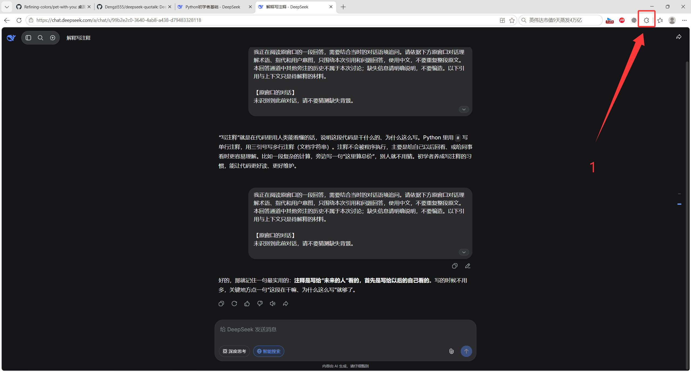
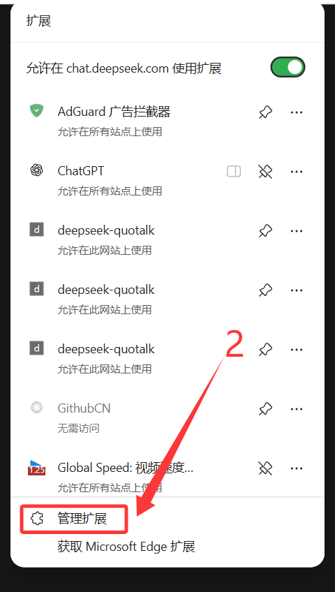
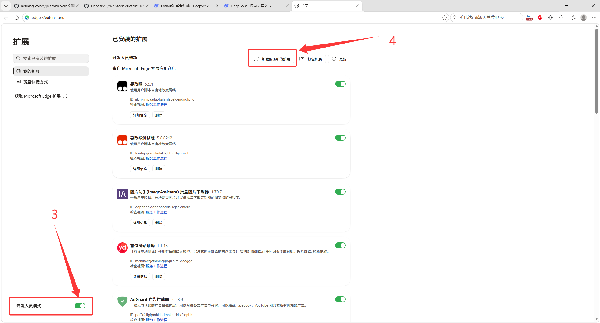
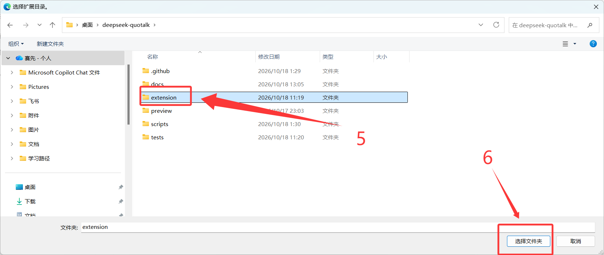
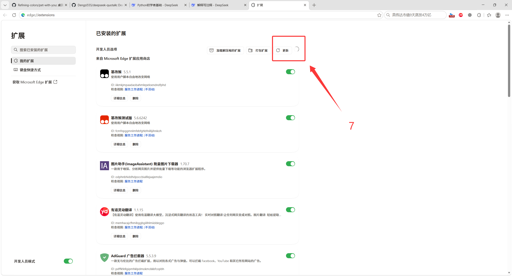
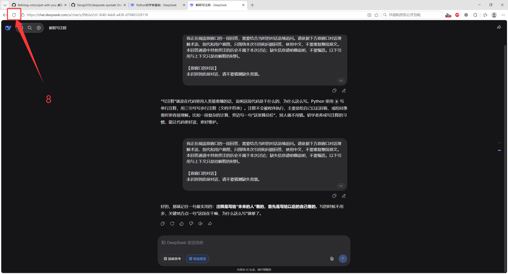
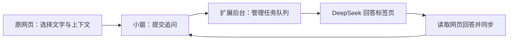

# deepseek-quotalk

> Select any text. Ask follow-ups. Stay in context.

在 DeepSeek 网页里选中一句看不懂的话，就地打开小窗实时追问，继续阅读原回答。

当前版本：**0.17.2**。

适用于 `https://chat.deepseek.com/` 的 Chromium Manifest V3 扩展。复用已登录的 DeepSeek 网页获取回答，无需填写 API Key；网页账户本身的可用性、额度与服务规则仍由 DeepSeek 决定。本项目独立开发，与 DeepSeek 官方无隶属关系。

**代码：MIT。动画：遵循原作非商用约定。** 完整含素材发行包不能视为全部采用 MIT，详见 [许可与署名](NOTICE.md)。

[安装](docs/INSTALL.md) · [使用](docs/USER_GUIDE.md) · [常见问题](docs/TROUBLESHOOTING.md) · [隐私](PRIVACY.md) · [开发](docs/DEVELOPMENT.md) · [上传 GitHub](docs/RELEASING.md) · [版本介绍](docs/RELEASE_NOTES.md)

## 能做什么

- **划词就地追问**：选中文字，点击“追问”，在独立小窗中解释、举例或继续提问。
- **流式显示**：回复边生成边显示；同一条追问回答期间可以继续输入，新问题排队发送。
- **选择上下文**：仅当前回答、最近 2 轮、最近 4 轮、全部对话；默认仅当前回答。
- **随时打开**：左键点桌宠，即使没有选中文字也能结合当前网页提问；小窗可拖动、调整大小和收起。
- **明暗主题**：小窗可手动切换深浅色，并记住选择。
- **两种形象**：pet-with-you 动画角色和蓝色 DeepSeek 鲸鱼。默认使用动画角色；动画角色默认中号，鲸鱼默认小号，各自记住尺寸。
- **100 段原版动画**：动画角色支持分类点播，可按 1／3／5／10 分钟间隔随机播放；待机与回答时自动切换状态。
- **退出后恢复**：退出隐藏桌宠和小窗；再次划词并点击“追问”，或点浏览器扩展图标，即可恢复。

## 安装：选中含 manifest.json 的 extension 文件夹

下载仓库源码（绿色 **Code → Download ZIP**）或安装包，先解压到长期保留的位置。以下使用 **Edge** 演示，按截图中的红色标注操作。

### 1. 打开浏览器扩展菜单

先下载并解压项目到固定位置。在 Edge 右上角点击拼图形状的“扩展”按钮（图中标注 **1**）。也可以直接在地址栏输入 `edge://extensions`，跳到第 3 步。



### 2. 进入“管理扩展”

在扩展菜单底部点击 **“管理扩展”**（图中标注 **2**）。截图中的其他扩展无需安装，deepseek-quotalk 只需加载一份。



### 3. 开启开发人员模式，加载扩展

打开左下角的 **“开发人员模式”**（图中标注 **3**），再点击上方 **“加载解压缩的扩展”**（图中标注 **4**）。



### 4. 选中 extension 文件夹

在解压后的项目目录里，选中 **`extension` 文件夹**（图中标注 **5**），点击 **“选择文件夹”**（图中标注 **6**）。这一层应直接包含 `manifest.json`；不要选 ZIP、项目最外层或 `assets`。



### 5. 确认扩展已加载

加载完成后，在扩展列表中确认 **deepseek-quotalk** 已启用。图中标注 **7** 的 **“更新”是可选操作**，首次安装不必额外点击。今后修改或替换扩展文件后，可点击本扩展卡片上的重新加载按钮。



### 6. 刷新 DeepSeek，开始划词追问

打开并登录 [DeepSeek 网页](https://chat.deepseek.com/)，点击浏览器刷新按钮（图中标注 **8**）。在回答里选中至少两个字符，点击出现的 **“追问”**，输入问题并按 Enter；也可以直接点击桌宠打开小窗。



无需安装 Node.js、Python、桌宠原项目或其他扩展。**加载后不要删除或移动解压目录。** Chrome 用户在地址栏打开 `chrome://extensions`，开启“开发者模式”，再加载同一个 `extension` 文件夹。更多更新与移除说明见 [安装文档](docs/INSTALL.md)。

## 回答从哪里来



小窗是网页回答的显示入口。当前使用阅读窗口中的独立 DeepSeek 回答标签页；只在该页首次提问时切过去，确认网页请求发出后立即返回阅读页，不等回答完成。回答页保持打开时，后续追问复用它且不再切页。关闭后重新创建的回答页会再初始化一次。打开小窗可以提前加载回答页，但此时不切换标签。

回答期间保留回答页，可手动切回原阅读页查看小窗；若浏览器暂停后台页面，可回到回答页等待完成。支持的聊天流直接同步可见回复，其他格式保留 DOM 兜底。登录、验证或网页错误需要在回答页中处理。

请保留回答页，也不要在它的输入框里另写草稿。它会在你的 DeepSeek 账户中形成真实会话；扩展不会绕过登录、验证码或网页限制。

## 桌宠与动作

右键角色：**选择形象 / 形象大小 / 动作 / 退出**。鲸鱼不显示动作栏。

动画默认原地待机，提问时切换思考；点播一个动作会播放一次，再恢复当前自动状态。“行走姿态”也只原地播放，不会带着桌宠自主跑动。100 段动画约 50 MiB，随扩展本地提供。

在“动作”第一项设置随机自动播放，默认关闭，可选每 1／3／5／10 分钟一次并记住选择。随机动作播放一次后恢复待机；回答中、手动动作播放中、网页隐藏、桌宠退出或选中鲸鱼时跳过当次触发，不补播、不发送问题。浏览器后台节流可能延后触发。

动画原作：[PC2005-cloud / dsh-pet](https://github.com/PC2005-cloud/dsh-pet)。本项目从 [Refining-colors / pet-with-you](https://github.com/Refining-colors/pet-with-you) 获取原版素材与分类参考，感谢原作者和维护者。素材允许开源使用、禁止商用，介绍、展示和分发时需保留原作链接，详见 [NOTICE.md](NOTICE.md)。

## 使用边界

- 只支持 DeepSeek 网页，不是浏览器里任意网站通用的 AI，也不是桌面独立桌宠。
- 上下文仅来自当前页面已加载且能识别的文字。“全部对话”仍有长度预算，不包含未加载的旧消息、附件原文和图片视觉内容。
- 小窗追问历史和后台会话也会影响后续回答；把范围改为“仅当前回答”不等于清空后台模型会话。
- 小窗消息、草稿与拖动位置不做持久化，刷新前请保存需要的内容。主题、上下文范围、形象、尺寸及随机动作间隔会保留。
- 当前回复以文字显示，不保证完整复现网页的 Markdown、公式或代码排版。
- DeepSeek 网页改版、浏览器休眠和网络状态可能影响发送、同步与完成状态判断。具体排查见 [常见问题](docs/TROUBLESHOOTING.md)。

## 开发与打包

扩展是原生 JavaScript，没有 npm 运行依赖。运行模拟测试需要 Node.js 22+，生成发行包需要 Python 3.9+：

```sh
node --test tests/*.test.cjs
python scripts/release.py
```

打包结果位于 `dist/`，包括安装包、源码包、公开文件清单与 SHA-256。脚本使用白名单，不打包本地提取素材、旧图片、个人目录或已有 ZIP。详见 [开发](docs/DEVELOPMENT.md) 与 [首次上传 GitHub](docs/RELEASING.md)。

## 数据与反馈

选中文字、问题及所选上下文会提交到你的 DeepSeek 网页会话。扩展没有自建服务、遥测或分析服务，动画从本地加载。权限与保存位置见 [PRIVACY.md](PRIVACY.md)。

在本仓库提交 Issue 时，请提供浏览器版本、扩展版本、复现步骤，以及已脱敏截图。不要上传账号、Cookie、完整抓包或私人对话。贡献说明见 [CONTRIBUTING.md](CONTRIBUTING.md)，安全问题见 [SECURITY.md](SECURITY.md)。
